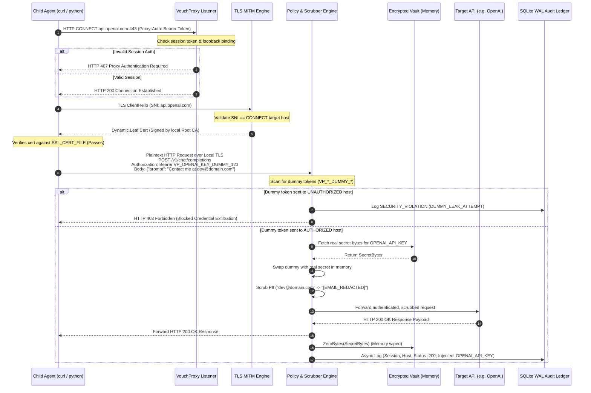

# System Floorplan & Trust Boundary Architecture: VouchProxy

**Classification:** Architectural Blueprint & Visual Request Floorplan  
**Author:** Senior Security Systems Architect  
**Status:** Canonical & Audited  

---

## 1. Top-Level Architectural Floorplan

```
+==================================================================================================================+
|                                              OPERATING SYSTEM WORKSTATION                                        |
+==================================================================================================================+
|                                                                                                                  |
|  [UNTRUSTED DOMAIN / CHILD AGENT]                                    [VOUCHPROXY SOVEREIGN ENCLAVE]               |
|                                                                                                                  |
|  +-------------------------------------+                              +---------------------------------------+  |
|  | Autonomous Agent Process Tree       |                              | VouchProxy Core Supervisor            |  |
|  | - claude-code / aider / gemini-cli  |                              | - 127.0.0.1:<ephemeral-port>          |  |
|  | - Subprocesses: curl, python, git   |                              | - Session Auth Secret Validator       |  |
|  +-------------------------------------+                              +---------------------------------------+  |
|       |                                                                            |      |                      |
|       | 1. Child Environment Injected:                                             |      |                      |
|       |    - HTTP_PROXY/HTTPS_PROXY = http://127.0.0.1:<port>                      |      |                      |
|       |    - SSL_CERT_FILE = ~/.vouchproxy/ca.crt                                  |      |                      |
|       |    - OPENAI_API_KEY = VP_OPENAI_KEY_DUMMY_123                              |      |                      |
|       v                                                                            |      |                      |
|  +-------------------------------------+                                           |      |                      |
|  | Outbound Request Emitted            |                                           |      |                      |
|  | Host: api.openai.com                |                                           |      |                      |
|  | Auth: Bearer VP_OPENAI_KEY_DUMMY... |                                           |      |                      |
|  +-------------------------------------+                                           |      |                      |
|       |                                                                            |      |                      |
|       | (Loopback Socket Connection)                                               |      |                      |
|       +=====================> [NETWORK LOOPBACK TRUST BOUNDARY] ===================+      |                      |
|                                                                                           |                      |
|                               [INTERNAL COMPONENT FLOORPLAN]                              |                      |
|                               +-------------------------------------------------------+   |                      |
|                               | A. HTTP/HTTPS CONNECT Listener (internal/proxy)       |   |                      |
|                               |    - Validates Proxy-Authorization Session Token      |   |                      |
|                               +-------------------------------------------------------+   |                      |
|                                                            |                              |                      |
|                                                            v                              |                      |
|                               +-------------------------------------------------------+   |                      |
|                               | B. TLS Dynamic MITM Engine (internal/certs)           |   |                      |
|                               |    - Reads ClientHello SNI                            |   |                      |
|                               |    - Enforces SNI == Host header invariant            |   |                      |
|                               |    - Mints/fetches leaf cert from LRU cache           |   |                      |
|                               +-------------------------------------------------------+   |                      |
|                                                            |                              |                      |
|                                                            v                              |                      |
|                               +-------------------------------------------------------+   |                      |
|                               | C. Policy & Rule Matcher (internal/policy)            |   |                      |
|                               |    - Evaluates host against vouch.yaml                |   |                      |
|                               |    - Scans for unauthorized Dummy Tokens              |   |                      |
|                               |    - Drops leak attempts with HTTP 403                |   |                      |
|                               +-------------------------------------------------------+   |                      |
|                                      |                                   |                |                      |
|                   (If Dummy Found &  |                                   | (If Scrubbing  |                      |
|                    Host Authorized)  |                                   |  Configured)   |                      |
|                                      v                                   v                |                      |
|               +-------------------------------+      +-------------------------+          |                      |
|               | D. Vault Module               |      | E. PII Scrubber         |          |                      |
|               |    - Memory-zeroed key fetch  |      |    - Redacts email,     |          |                      |
|               |    - Swaps dummy with real    |      |      hostname, username |          |                      |
|               +-------------------------------+      +-------------------------+          |                      |
|                                      |                                   |                |                      |
|                                      +-----------------+-----------------+                |                      |
|                                                        |                                  |                      |
|                                                        v                                  |                      |
|                               +-------------------------------------------------------+   |                      |
|                               | F. Upstream TLS Client (Zero-Rebind Resolver)         |   |                      |
|                               |    - Dial upstream host via real DNS resolver         |   |                      |
|                               |    - Pin IP address for connection duration           |   |                      |
|                               |    - Forward sanitized & authenticated payload        |   |                      |
|                               +-------------------------------------------------------+   |                      |
|                                                        |                                  |                      |
|       +================================================+                                  |                      |
|       |                                                                                   |                      |
|       v                                                                                   v                      |
|  [PERSISTENCE BOUNDARY (0600)]                                          [ASYNCHRONOUS AUDIT QUEUE]                |
|  +--------------------------------+                                     +-------------------------------------+  |
|  | ~/.vouchproxy/vault.enc        |                                     | SQLite WAL Ledger (audit.db)        |  |
|  | - Argon2id + AES-256-GCM       |                                     | - modernc.org/sqlite (Zero CGO)     |  |
|  | - Plaintext never on disk      |                                     | - Redacted paths, latency, action   |  |
|  +--------------------------------+                                     | - ZERO raw secrets written          |  |
|                                                                         +-------------------------------------+  |
+==================================================================================================================+
                                        | (Encrypted TLS Egress over Public Internet)
                                        v
                        +===============================+
                        | Upstream Provider APIs        |
                        | - api.openai.com              |
                        | - api.anthropic.com           |
                        | - api.github.com              |
                        +===============================+
```

---

## 2. Request Interception Pipeline Floorplan (Mermaid)



---

## 3. Trust Boundary Layer Analysis

VouchProxy defines four non-overlapping security tiers:

| Tier | Boundary Name | Permitted Input | Prohibited Operations | Security Controls |
|:---|:---|:---|:---|:---|
| **Tier 0** | **Untrusted Child Agent** | Non-functional dummy tokens, local CA cert path, proxy env vars. | Accessing `.env`, reading raw credentials, establishing direct internet connections bypassing proxy. | OS process isolation, `NO_PROXY=""` enforcement, empty `.env` masking. |
| **Tier 1** | **Localhost Loopback Boundary** | Loopback TCP connections (`127.0.0.1`) with valid `Proxy-Authorization` header. | Unauthenticated loopback requests, connections from non-loopback interfaces. | Ephemeral port binding, 32-byte session token validation, drop unauthenticated calls with 407. |
| **Tier 2** | **VouchProxy Sovereign Enclave** | Decrypted credentials in volatile RAM, policy evaluation engine, MITM cert minting. | Long-term caching of raw secret strings, outputting secrets to logs, exposing endpoints outside loopback. | `[]byte` secret slices, explicit `ZeroBytes()` with `runtime.KeepAlive()`, atomic temporary file writing. |
| **Tier 3** | **Persistent Storage Boundary** | `vault.enc` (encrypted ciphertext), `ca.key` (private key), `audit.db` (sanitized SQLite). | Plaintext secret writes, group/world readable file permissions. | `0600` POSIX / strict Windows DACL, Argon2id + AES-256-GCM authenticated encryption. |

---

## 4. Module Dependency Floorplan

```
cmd/vouchproxy/main.go
  │
  ├──> internal/runner (Process Supervisor)
  │      ├──> internal/proxy (HTTP/HTTPS Proxy Engine)
  │      │      ├──> internal/certs (CA & Leaf Cert Minting)
  │      │      ├──> internal/policy (vouch.yaml Evaluation)
  │      │      │      └──> internal/vault (Secret Decryption & Memory Zeroing)
  │      │      │             └──> internal/crypto (Argon2id, AES-256-GCM, ZeroBytes)
  │      │      └──> internal/audit (SQLite WAL Asynchronous Ledger)
  │      │
  │      └──> OS Process Group / Win32 Job Object Tree Manager
  │
  └──> CLI Commands: init, secret, audit, status
```
- **Strict Layering Invariant:** `internal/crypto` has zero dependencies on proxy or policy.
- `internal/audit` never imports `internal/vault`, guaranteeing by compile-time package boundaries that audit routines cannot read or log real credentials.
