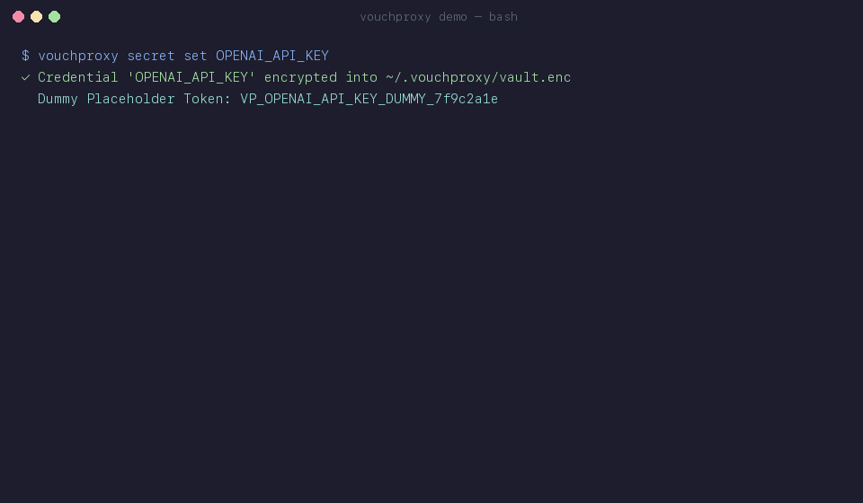

# VouchProxy

A lightweight local proxy that stops AI coding agents from seeing or leaking your real API keys.



Instead of putting live API keys in `.env` files or terminal environments where agents can read them, VouchProxy runs the agent with non-functional dummy tokens (e.g. `VP_OPENAI_KEY_DUMMY_...`). When the agent calls an authorized API, VouchProxy intercepts the request on loopback, swaps the dummy token for your real key in memory, and forwards the call. If the agent tries to send the token anywhere else, the request is blocked.

---

## Installation

### One-Line Installers (Pre-Built Static Binaries)

**macOS & Linux:**
```bash
curl -fsSL https://raw.githubusercontent.com/sshloktiwarii/vouchproxy/main/install.sh | sh
```

**Windows (PowerShell):**
```powershell
irm https://raw.githubusercontent.com/sshloktiwarii/vouchproxy/main/install.ps1 | iex
```

### Build from Source (Go 1.22+)
```bash
git clone https://github.com/sshloktiwarii/vouchproxy.git
cd vouchproxy
make build
sudo install -m 0755 bin/vouchproxy /usr/local/bin/
```

---

## Who Needs This

- **Developers using autonomous coding agents** (`claude-code`, `aider`, `cursor`, `gemini-cli`) that run terminal commands and inspect project files.
- **Engineers running MCP servers** where tool parameters or context logs could expose bearer tokens.
- **Teams preventing prompt injection exfiltration**, ensuring compromised agent instructions cannot send API credentials to third-party endpoints.

---

## Core Capabilities in v1.1.0

### 1. Zero-Privilege Shell Integration (`vouchproxy env`)
Activate full proxy protection, Root CA trust, and dummy token environment variables across your entire shell session without root, eBPF, or pfctl privileges:

```bash
# Bash / Zsh
eval "$(vouchproxy env)"

# Fish
vouchproxy env --shell=fish | source

# Windows PowerShell
vouchproxy env | Invoke-Expression

# Deactivate proxy in current shell
eval "$(vouchproxy env -u)"
```

### 2. $O(1)$ Rolling-Window Body Streaming
VouchProxy processes multi-gigabyte uploads with bounded, constant $O(1)$ memory usage. Backed by `sync.Pool` 64 KB buffers with a rolling overlap tail, dummy credentials, PII patterns, and canary signatures are detected and rewritten even when split across HTTP chunk boundaries. If an unauthorized token or canary signature appears mid-stream, the connection is immediately aborted before sensitive bytes leave the socket.

### 3. Automatic MCP Context Canary Watermarking
When Model Context Protocol (MCP) proxy mode is active, responses from context-reading tools (`read_file`, `grep_search`, `view_file`, `cat`) are automatically watermarked with deterministic, session-signed zero-width Unicode signatures. If an indirect prompt injection instructs an agent to exfiltrate file content to an untrusted domain, VouchProxy's egress scanner halts the request with `HTTP 403 Forbidden` and logs the attack to the audit ledger.

---

## Benchmarks & Numbers

Measured on Apple M-series (`darwin/arm64`):

| Metric | Measured Value |
|:---|:---|
| **Binary Size** | ~8.6 MB (single static executable, zero CGO dependencies) |
| **Hot-Path Added Latency** | 0.039 ms (~40 microseconds per request) |
| **Memory Allocation** | Strict $O(1)$ streaming via `sync.Pool` 64 KB buffers |
| **Throughput & Concurrency** | 500+ parallel requests tested with zero data races |
| **Startup Overhead** | < 15 ms to bind loopback, load vault, and launch child process |

---

## Quickstart

### 1. Set Up Your Vault
```bash
# Initialize local Root CA and encrypted vault (~/.vouchproxy)
vouchproxy init

# Store your real API keys in the local encrypted vault
vouchproxy secret set OPENAI_API_KEY
vouchproxy secret set ANTHROPIC_API_KEY
vouchproxy secret set GITHUB_TOKEN
```

### 2. Run Any Agent Under VouchProxy

**Option A: Sandboxed Process Runner**
```bash
# Run your coding agent — real keys are kept out of the agent's environment
vouchproxy run -- aider --model sonnet

# Or test with curl
vouchproxy run -- curl -i -H "Authorization: Bearer $OPENAI_API_KEY" https://api.openai.com/v1/models
```

**Option B: Shell-Wide Activation**
```bash
eval "$(vouchproxy env)"
cursor .
```

### 3. Audit Traffic
```bash
# View intercepted requests and substitutions in real time
vouchproxy audit --tail
```

---

## Configuration (`vouch.yaml`)

Configuration resides at `~/.vouchproxy/vouch.yaml`.

```yaml
version: "1.0"

settings:
  strict_mode: false            # Block egress to hosts not defined in rules
  proxy_auth_required: true     # Require per-session bearer token from child
  mitm_cache_size: 500          # Number of generated TLS certs kept in memory
  connect_timeout_seconds: 15
  request_timeout_seconds: 60

canary:
  enabled: true                 # Detect decoy canary tokens in outbound payloads
  default_ttl: "24h"            # Expiry duration for minted tokens
  block_on_detect: true         # Block egress immediately when canary is detected

keyring:
  enabled: true                 # Secure vault master passphrase in OS keychain
  service: "vouchproxy"

system_trust:
  enabled: false                # Temporarily register Root CA into OS trust store

mcp:
  enabled: true                 # Filter stdio JSON-RPC tool calls and scrub arguments
  auto_watermark: true          # Inject session-signed zero-width canary watermarks into file reads
  blocked_paths:
    - "/etc/shadow"
    - "~/.ssh"
    - "~/.aws"

scrubbing:
  emails: true                  # Redact email addresses from outbound requests
  usernames:                    # Redact local system identities
    - "$USER"
    - "$HOSTNAME"
  custom_regex:
    - name: "Internal-IPv4"
      pattern: '\b(?:10|172\.(?:1[6-9]|2[0-9]|3[01])|192\.168)\.[0-9]{1,3}\.[0-9]{1,3}\b'
      replacement: "[INTERNAL_IP_REDACTED]"

rules:
  - name: "OpenAI API"
    host: "api.openai.com"
    match_type: "exact"
    allowed_methods: ["POST", "GET"]
    headers:
      - name: "Authorization"
        format: "Bearer {{secret}}"
        secret: "OPENAI_API_KEY"
        dummy_match: "VP_OPENAI_API_KEY_DUMMY_*"
```

---

## License

MIT
